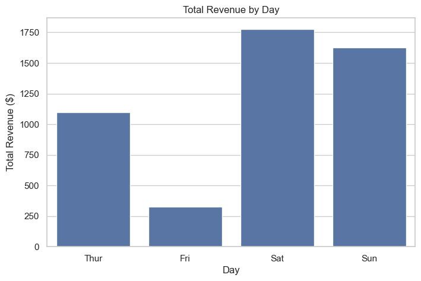
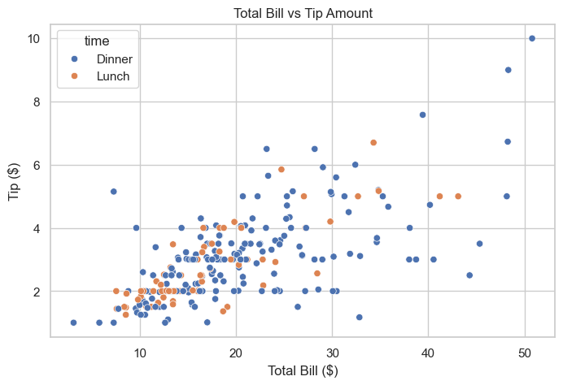

# Restaurant Sales & Tipping Analysis

Exploratory data analysis of 244 restaurant bills to understand revenue patterns and customer tipping behavior.

## Business Questions
1. Which day and time bring in the most revenue?
2. How much do customers tip as a percentage of the bill?
3. Does party size affect tip percentage?
4. Do smokers and non-smokers tip differently?

## Tools Used
Python, Pandas, Matplotlib, Seaborn, Jupyter Notebook

## Dataset
Restaurant tips dataset (244 records, 7 columns) from the [seaborn-data](https://github.com/mwaskom/seaborn-data) repository.

## Key Findings
- Saturday and Sunday generate about 70% of total revenue.
- Dinner accounts for about 76% of revenue, with a higher average bill than lunch ($20.80 vs $17.17).
- The average tip is 16.1% of the bill (median 15.5%).
- Larger groups tip a slightly lower percentage (16.6% for 2 people down to 14.2% for 5).
- Smoking status has almost no effect on tipping (16.3% vs 15.9%).

## Visualizations

## Limitations
- Small sample (244 records), so results describe this sample only.
- Friday has only 19 visits, and party sizes 1, 5 and 6 have fewer than 6 visits each.

## How to Run
1. Clone this repository
2. Install the libraries: `pip install -r requirements.txt`
3. Open `restaurant_tipping_analysis.ipynb` in Jupyter Notebook and run all cells

## Author
Your Name | [LinkedIn](https://www.linkedin.com/in/your-profile)
